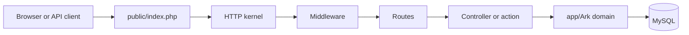

# How ARK Core is built

<!-- source: bootstrap/app.php -->

ARK Core is a Laravel 13 application on PHP 8.3+. Domain code lives under `app/Ark`, not in a generic `app/Services` pile. HTTP entry is `public/index.php`. Route registration is `bootstrap/app.php`.

## Request lifecycle

`bootstrap/app.php` loads:

| File | Audience |
| --- | --- |
| `routes/web.php` | Staff shop UI, session auth |
| `routes/api.php` | `/api/desk`, `/api/mobile`, `/api/tech`, `/api/station`, `/api/dragon-agent` |
| `routes/install.php` | `/setup` |
| `routes/portal.php` | Customer portal |
| `routes/auth.php` | Staff login |
| `routes/public.php` | Public site responses Core still serves |
| `routes/oidc.php` | OIDC issuer, only when that issuer middleware allows it |
| `routes/cloud.php`, `routes/cloud-ingress.php` | Cloud redirects and cloud ingress |
| `routes/channels.php` | Broadcast channel authorization |
| `routes/console.php` | Artisan closures |

Web requests get the session stack, CSRF, the installer redirect, an active-user check, and repair-order estimate locking. API requests are stateless except for Sanctum bearer tokens, and they also run the estimate lock middleware. API and AJAX requests render exceptions as JSON.

Before the database exists, `AppServiceProvider` forces file sessions, file cache, and the sync queue when installation state is not installed. That is what lets `/setup` run.

## Directories

| Path | What belongs there |
| --- | --- |
| `app/Ark/Operations` | Shop operations: repair orders, inspections, financials, messaging, scheduling |
| `app/Ark/Mobile`, `Desk`, `Tech`, `Station` | Client projections and HTTP controllers for those APIs |
| `app/Ark/Runtime` | Authorization enums, installer-adjacent runtime, exceptions |
| `app/Ark/Install` | First-run state |
| `app/Ark/Dragon` | Model assistant |
| `app/Ark/Platform` | Bindings that talk to ARK-operated services |
| `app/Ark/Vehicles` | VIN and vehicle text |
| `app/Models` | Framework-level models such as `User` |
| `app/Providers` | Service providers |
| `database/migrations` | Schema history |
| `resources/views` | Blade |
| `resources/js`, `resources/css` | Vite assets |
| `tests` | Pest tests |

Namespaces follow those folders: `App\Ark\Operations\RepairOrders\RepairOrder`.

## Domain boundaries

Operations code owns shop truth: a repair order, its concerns, its inspection, its ledger. Mobile, Desk, Tech, and Station code are projections and controllers over that truth. They should not become a second place that calculates tax.

Platform code is the edge toward services ARK operates. Stock bindings for telephony and the parts catalog are the not-configured implementations. Replacing them is an extension. Treating Platform classes as a public SDK is not.

## Dependency injection

Providers are listed in `bootstrap/providers.php`: application provider, booking surface, Horizon, shop memory, Dragon agent, and the platform website provider.

`AppServiceProvider::register()` binds the contracts other code asks for. Notable ones:

| Contract | Stock binding |
| --- | --- |
| `TelephonyProvider` | `NotConfiguredTelephonyProvider` |
| `PartsCatalogLauncher` | Not-configured, unless the parts catalog driver is `platform` |
| `OutboundSmsTransport` | `PlatformOutboundSmsTransport` |
| `PdfRenderer` | `HeadlessChromiumPdfRenderer` |
| `PushTransport` | `FirebasePushTransport` |
| `VehicleIntelligenceManager` | NHTSA provider |

Laravel resolves these when a controller type-hints them. There is no second plugin container.

## What to leave alone

Change projections and add listeners at the edges. Be careful with:

- Ledger writes and anything that sets a repair-order total
- Approval recording
- Installer state and `APP_KEY` handling
- Portal token hashing
- The status catalog's allowed transitions

Those are shop integrity, not presentation. The [extension guide](/extending/) names the mechanisms that are safe to use and the ones that will break on the next pull.
