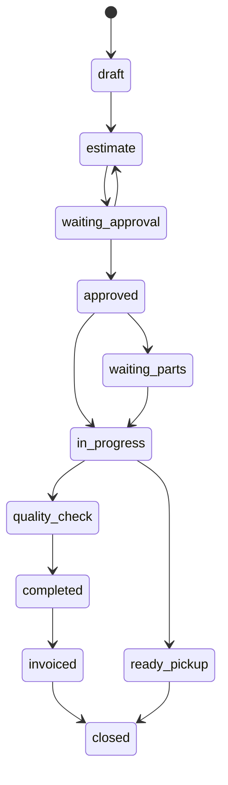

# Lifecycles

<!-- source: app/Ark/Operations/RepairOrders/RepairOrderStatus.php -->

## Repair order

A repair order moves through the slugs in [Customers, vehicles, and repair orders](/guide/customers-vehicles-repair-orders). Intake is draft and estimate. Waiting approval is the customer-decision state. Approved work can wait on parts, sit ready, or be in progress. Terminal, when the catalog is not overriding it, is closed.

The diagram follows `legacyAllowedOperationalTransitions()` and omits some return edges so it stays readable. The catalog is the runtime authority after it boots. Clients must treat a rejected transition as a 4xx from Core, not as a status to store locally.

Concurrent estimate edits use `RepairOrderConcurrency` and the `CommitRepairOrderEstimateLock` middleware. A conflict raises `RepairOrderEstimateConflictException`, which is rendered by the exception handler and is not reported as an unexpected crash.

## Inspection

An inspection belongs to one repair order. Items are checklist rows with a status, note, and optional measurements. Photos attach to items through `InspectionEvidenceStore` on the web workflow. The Tech API updates items and can include a photo on that patch. The mobile API can read an inspection photo and can attach separate evidence objects to a concern or the repair order.

Recording a finding does not by itself approve the estimate.

## Money

The server owns totals. Presenters and API projections show labels and amounts that were already computed. Technician viewers receive a null estimate block on the mobile repair-order projection. That is deliberate.

Ledger entries record payments, deposits, refunds, and voids. Voiding is a ledger operation, not a row delete that rewrites history in the browser.

## Communications

Inbound conversation messages dispatch `ConversationMessageReceived`. That event broadcasts on a private channel and is listened to by the mobile push dispatcher. Approval rows dispatch a created-model hook that can notify mobile devices of an approved estimate.

Those events fire when the corresponding write happens inside Core. They are not an outbound webhook to a URL you configure.

## Files

Evidence and inspection media are stored on a filesystem disk and referenced by a storage path on the row. Download controllers stream the file after an authorization check. They do not hand the client a permanent public URL as the access model.

## Frontend

The staff UI is Blade plus a Vite bundle (Tailwind, Alpine). It is not a separate SPA that owns shop state. Live updates use Laravel Echo and Reverb when broadcasting is configured. When `BROADCAST_CONNECTION=log`, the page still works. It simply does not receive push updates.

Error reporting for unexpected exceptions goes through `ExceptionReporter` from the exception handler in `bootstrap/app.php`. HTTP 4xx responses are not reported as application failures.
