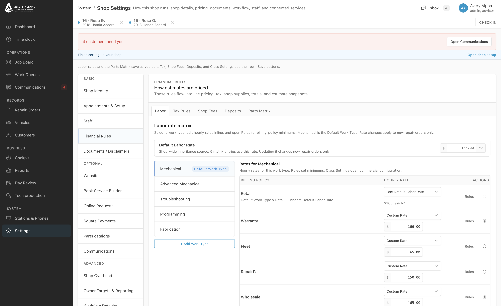
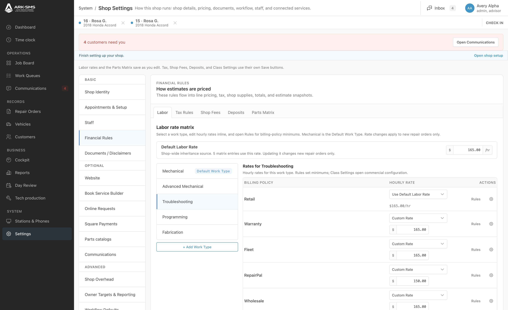
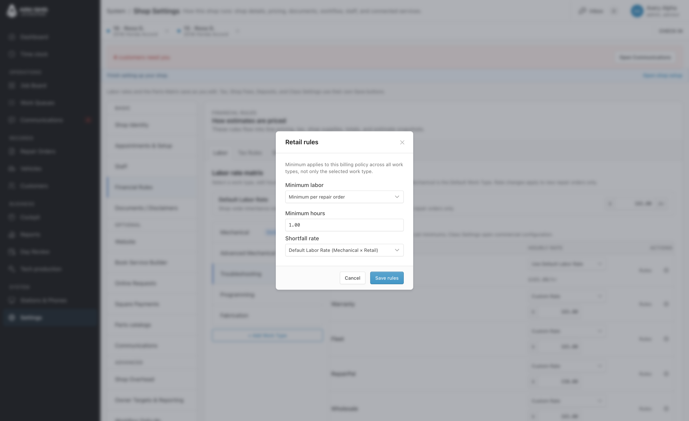
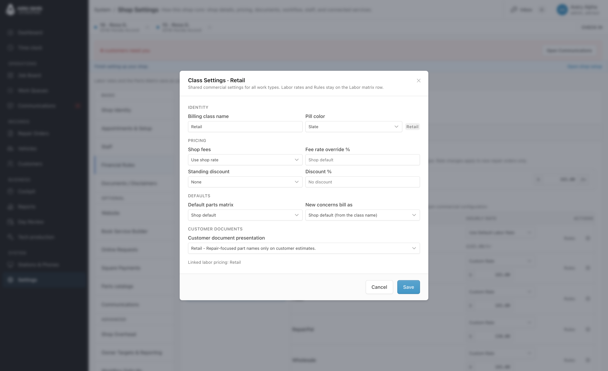
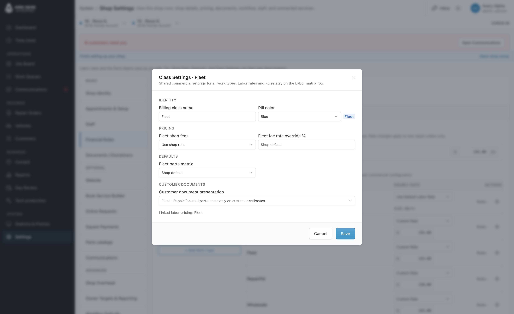
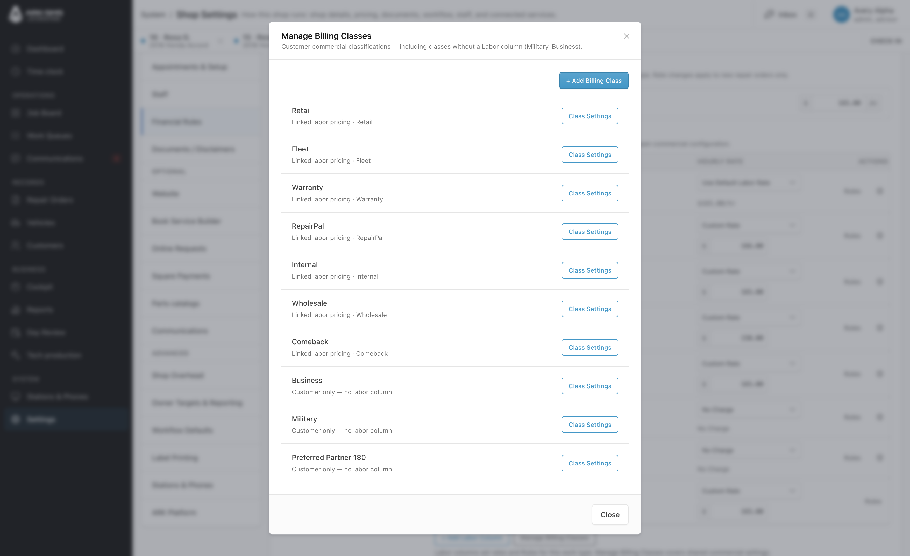
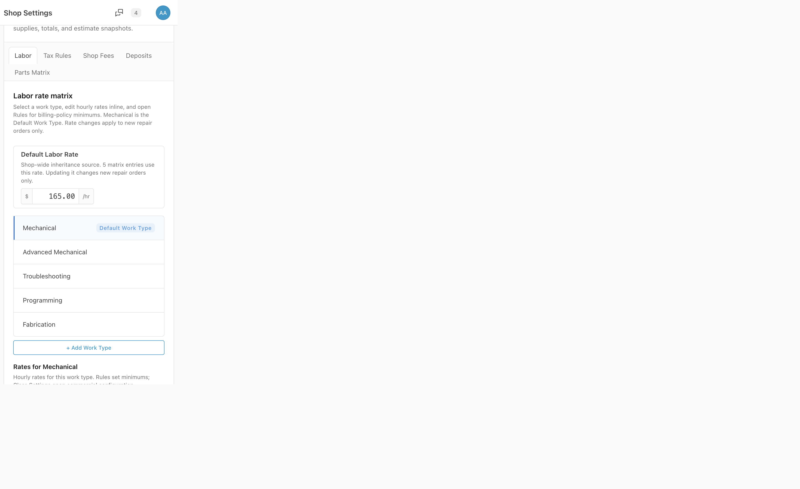

# ARK Core #180 — Labor UI polish visual evidence

Independent review package for the staging Labor / Billing Classes presentation pass.

## Capture metadata

| Field | Value |
| --- | --- |
| Core commit | [`53e6d88c2706b0f9cc554b9541887c93743dc1c8`](https://github.com/EdwardSoaresJr/ark-core/commit/53e6d88c2706b0f9cc554b9541887c93743dc1c8) |
| SaaS / Stancl pin | [`8dc38a139999d4ad116c3669d2c2bf76b8a61b3e`](https://github.com/EdwardSoaresJr/ark-stancl/commit/8dc38a139999d4ad116c3669d2c2bf76b8a61b3e) (`pin/core-53e6d88-labor-ui-polish`) |
| Feature branch | `settings/labor-matrix-billing-minimums` |
| Environment | Staging (`APP_ENV=staging`) on `157.230.172.143` |
| Review host | `https://alpha.staging.arksms.com` |
| Capture date | 2026-11-10 |
| Production | Untouched. No production deploy authorized. |

These are live browser screenshots of the rendered Tabler UI on staging, not HTML mockups.

## Screenshots

### 1. Mechanical Labor Matrix

**File:** [`01-mechanical-labor-matrix.png`](./01-mechanical-labor-matrix.png)

**Demonstrates:** Vertical Work Types with Mechanical selected; Default Labor Rate; Billing Policy / Hourly Rate / Actions columns; compact adjacent Rules + Class Settings actions; corrected autosave helper copy.

### 2. Troubleshooting Labor Matrix

**File:** [`02-troubleshooting-labor-matrix.png`](./02-troubleshooting-labor-matrix.png)

**Demonstrates:** Work Type selection persists in the URL (`work_type=diagnostic`); Rates for Troubleshooting; same compact action pattern without redesigning navigation.

### 3. Retail Rules modal

**File:** [`03-retail-rules-modal.png`](./03-retail-rules-modal.png)

**Demonstrates:** Compact Rules modal; scope note that minimums apply across Work Types for the billing policy; Cancel / Save rules retained.

### 4. Retail Class Settings

**File:** [`04-retail-class-settings.png`](./04-retail-class-settings.png)

**Demonstrates:** Grouped Identity / Pricing / Defaults / Customer Documents; pill preview; readable **Linked labor pricing: Retail**; Cancel / Save retained.

### 5. Fleet Class Settings

**File:** [`05-fleet-class-settings.png`](./05-fleet-class-settings.png)

**Demonstrates:** Same commercial editor for Fleet; readable **Linked labor pricing: Fleet**; Fleet-specific fields only (no invented discount/default controls).

### 6. Manage Billing Classes

**File:** [`06-manage-billing-classes.png`](./06-manage-billing-classes.png)

**Demonstrates:** Manage list including Military and Business (customer-only classes with no Labor column); readable linked-labor labels; technical keys available via tooltip, not as primary text.

### 7. Mobile Labor layout

**File:** [`07-mobile-labor-layout.png`](./07-mobile-labor-layout.png)

**Demonstrates:** Narrow-viewport Labor layout — Default Labor Rate, vertical Work Types, then Rates for Mechanical stacking without horizontal page overflow.

## Privacy notes

- Captured on synthetic staging tenant `alpha`.
- Visible staff identity is the synthetic staging account **Avery Alpha**.
- No customer emails, phone numbers, payment tokens, cookies, or credentials are shown in these frames.
- Workspace chrome may show synthetic staging repair-order labels; no production customer data.

## Known limitations

- Screenshots document presentation only. They do not prove pricing math, authorization ceilings, payments, or tenant isolation.
- Fleet / Warranty Class Settings intentionally omit Retail-only standing-discount / new-concerns controls when those fields do not apply.
- Mobile capture uses a narrow device metrics override inside the review browser; layout is authentic, but browser chrome differs from a physical phone.
- Static **Ready.** status was removed; request-backed Saving… / All changes saved / Could not save may not appear in a still frame.
- Production deployment is **not** authorized by this evidence package.
